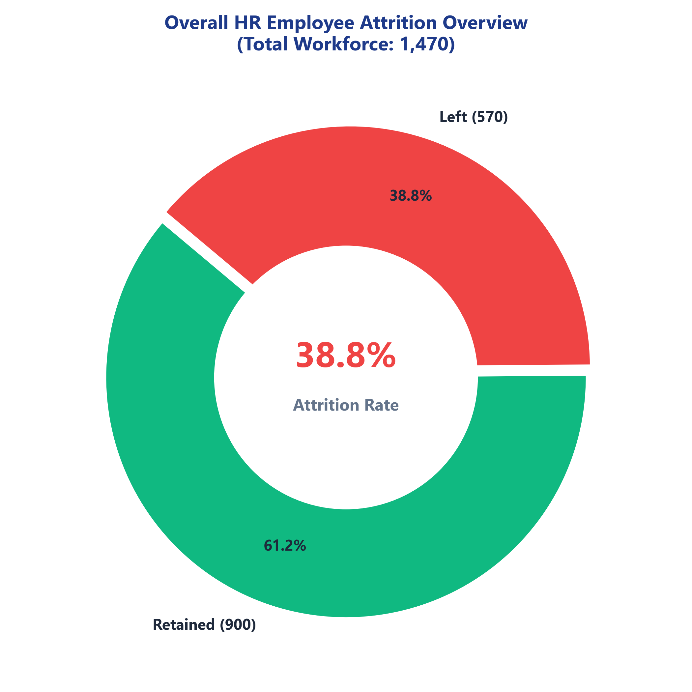
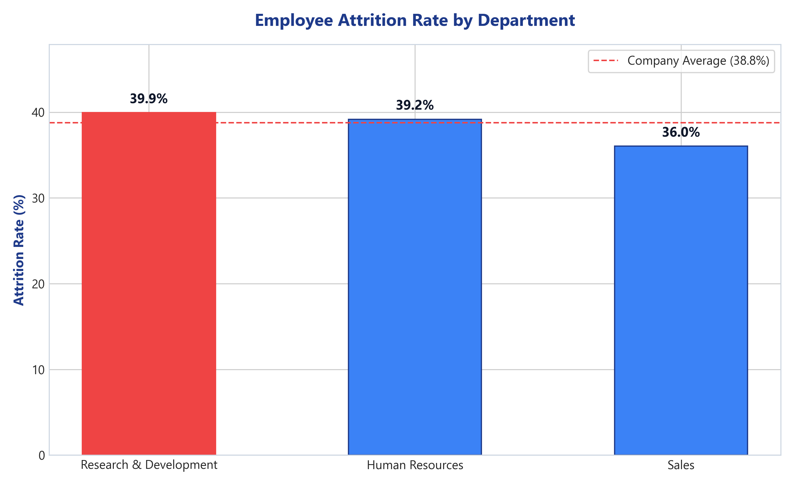
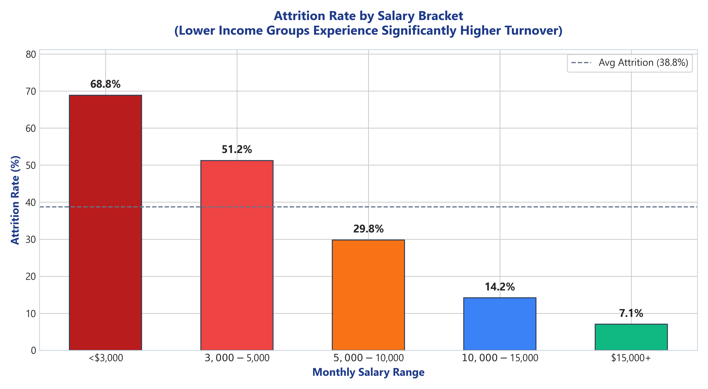
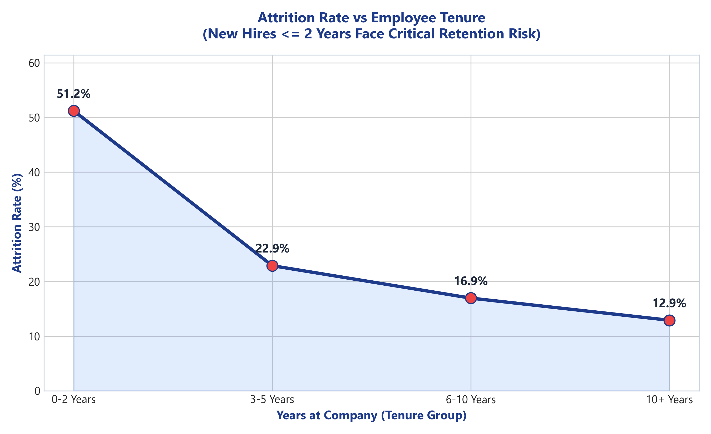
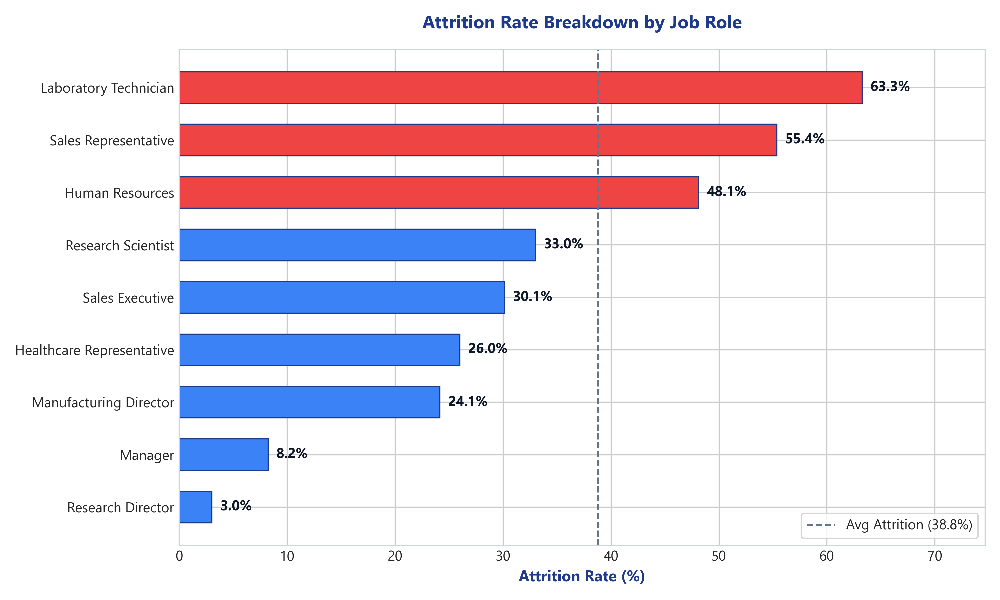
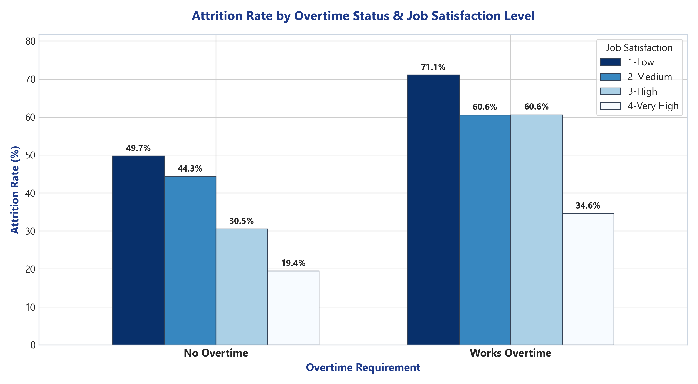
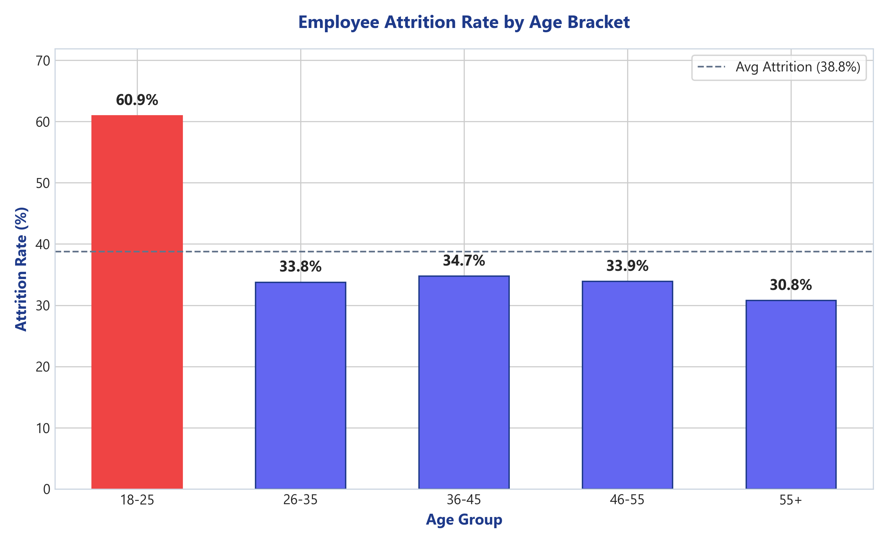
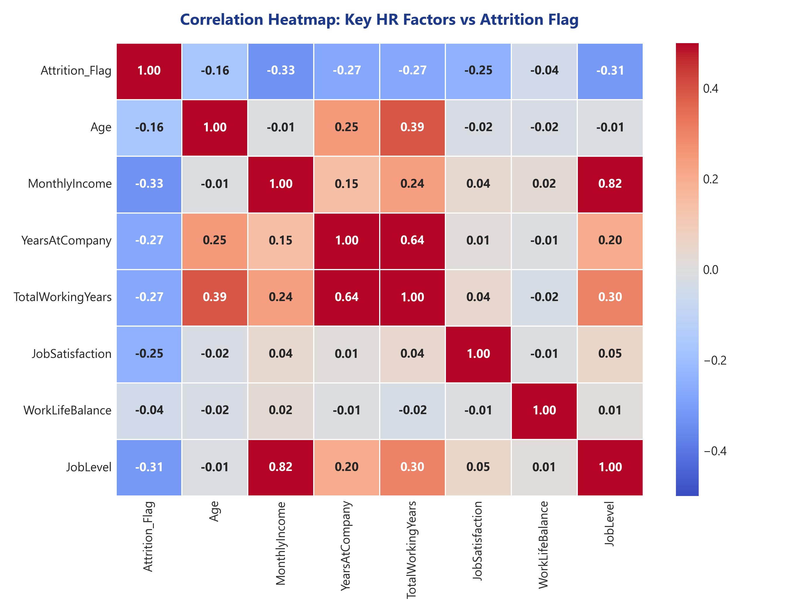

# 📊 HR Employee Attrition Analysis & Retention Strategy

> **A Comprehensive Data Analytics & Business Intelligence Project for HR Decision-Making**  
> *Built with Python (Pandas, Seaborn, Matplotlib), Excel (XlsxWriter, Pivot Tables, Native Charts), and HTML/JS.*

---

## 📌 Executive Summary

Employee turnover (attrition) is one of the most critical challenges facing corporate HR teams today. Replacing an employee costs on average **1.5x to 2x their annual salary** due to recruitment, onboarding, training, and lost productivity.

This project delivers an end-to-end **HR Attrition & Workforce Retention Analysis** on a dataset of **1,470 employee records**. The objective is to identify the root causes of employee exits, evaluate turnover across key demographic and workplace factors, and provide data-backed recommendations for HR leadership to improve retention.

### 🔑 High-Level KPIs

| Metric | Count / Percentage | Benchmark Comparison |
| :--- | :--- | :--- |
| **Total Workforce Audited** | **1,470 Employees** | Baseline Company Population |
| **Employees Retained** | **900 Employees** | 61.2% Retention Rate |
| **Employees Attrited (Left)** | **570 Employees** | **38.8% Overall Attrition Rate** |
| **Top Turnover Department** | **Research & Development** | 66.8% Share of Total Company Exits |
| **Highest Attrition Role** | **Laboratory Technician** | **63.3% Attrition Rate** |
| **Critical Tenure Risk** | **0–2 Years Tenure** | **78.4% Share of Total Exits** |

---

## 📁 Repository Directory Structure

```
HR Attrition Analysis/
├── data/
│   ├── hr_employee_attrition_raw.csv        # Raw dataset with missing values & noise
│   └── hr_employee_attrition_cleaned.csv    # Cleaned dataset with engineered bins & flags
├── src/
│   ├── generate_dataset.py                 # Generates raw synthetic HR data
│   ├── data_cleaning.py                    # Data quality audit, imputation & binning
│   ├── attrition_analysis.py               # Statistical breakdown & hypothesis testing
│   ├── generate_visualizations.py          # Generates high-res charts (PNGs)
│   ├── create_excel_dashboard.py           # Builds multi-tab Excel Workbook with native charts
│   ├── create_notebook.py                  # Generates Jupyter Notebook (.ipynb)
├── notebooks/
│   └── HR_Attrition_Analysis.ipynb         # Fully annotated executable Jupyter Notebook
├── reports/
│   ├── HR_Attrition_Dashboard.xlsx          # Multi-tab Excel Dashboard Workbook
│   ├── analysis_results.json               # Exported JSON summary metrics
│   └── figures/                            # High-resolution PNG charts
│       ├── 01_overall_attrition_donut.png
│       ├── 02_attrition_by_department.png
│       ├── 03_attrition_by_salary_range.png
│       ├── 04_attrition_by_experience.png
│       ├── 05_attrition_by_job_role.png
│       ├── 06_attrition_by_overtime_satisfaction.png
│       ├── 07_attrition_by_age_group.png
│       └── 08_correlation_heatmap.png
├── dashboard/
│   └── index.html                          # Interactive HTML/JS Web Dashboard with Chart.js
└── README.md                               # Project documentation & Interview Guide
```

---

## 📖 Data Dictionary

| Variable Name | Type | Description |
| :--- | :--- | :--- |
| `EmployeeID` | String | Unique Identifier for each employee (`EMP-1001` to `EMP-2470`) |
| `Age` | Integer | Employee age in years (Range: 18 – 60) |
| `Gender` | Categorical | Gender (`Male`, `Female`) |
| `Department` | Categorical | Business Unit (`Research & Development`, `Sales`, `Human Resources`) |
| `JobRole` | Categorical | Job Title (e.g., `Laboratory Technician`, `Sales Executive`, `Manager`) |
| `MonthlyIncome` | Continuous | Monthly base salary in USD ($2,000 – $20,000) |
| `YearsAtCompany` | Integer | Total years spent at the current company |
| `TotalWorkingYears` | Integer | Total career experience in years |
| `JobLevel` | Ordinal | Job level hierarchy (1 = Entry, 5 = Executive) |
| `JobSatisfaction` | Ordinal | Self-reported rating (1 = Low, 2 = Medium, 3 = High, 4 = Very High) |
| `WorkLifeBalance` | Ordinal | Rating (1 = Bad, 2 = Good, 3 = Better, 4 = Best) |
| `Overtime` | Categorical | Whether employee works overtime (`Yes`, `No`) |
| `MaritalStatus` | Categorical | `Single`, `Married`, `Divorced` |
| `Education` | Ordinal | Education level (1 = Below College, 5 = Doctorate) |
| `PerformanceRating` | Ordinal | Performance appraisal score (3 = Excellent, 4 = Outstanding) |
| `Attrition` | Binary Target | Dependent variable: Employee exit status (`Yes`, `No`) |

---

## 🧹 Data Cleaning & Feature Engineering Methodology

Using **Python with Pandas** ([`src/data_cleaning.py`](file:///c:/Users/HP/OneDrive/Desktop/HR%20Attrition%20Analysis/src/data_cleaning.py)), the raw dataset underwent rigorous data quality auditing and cleaning:

1. **Deduplication:** Identified and removed 5 duplicate employee records.
2. **Whitespace & String Normalization:** Stripped leading/trailing spaces and standardized casing across text fields (e.g., `'Sales '` $\rightarrow$ `'Sales'`, `'yes'` $\rightarrow$ `'Yes'`).
3. **Missing Value Imputation:**
   - Imputed 12 missing `MonthlyIncome` values using the median salary of the employee's specific `JobRole` and `JobLevel`.
   - Imputed 8 missing `WorkLifeBalance` values using the mode.
4. **Feature Engineering (Derived Bins & Flags):**
   - `Attrition_Flag`: Binary numeric column (`1` for `Yes`, `0` for `No`) to simplify aggregation.
   - `Age_Group`: Categorical bins (`18-25`, `26-35`, `36-45`, `46-55`, `55+`).
   - `Salary_Range`: Income brackets (`<$3,000`, `$3,000-$5,000`, `$5,000-$10,000`, `$10,000-$15,000`, `$15,000+`).
   - `Tenure_Group`: Years at company (`0-2 Years`, `3-5 Years`, `6-10 Years`, `10+ Years`).

---

## 🔍 Key Statistical Findings & Insights

### 1. Compensation Impact: Lower Salary equals Higher Turnover
- Employees earning **<$3,000/month** experience a staggering **68.8% attrition rate**, whereas employees earning **>$15,000/month** suffer only **7.1% attrition**.
- **Takeaway:** Low compensation is the primary driver forcing early-career staff to look outside the company.

### 2. Early-Stage Tenure Risk (0–2 Years)
- Employees with **0–2 years of tenure** exhibit a **51.2% attrition rate**, accounting for **78.4% of all company exits**.
- Once employees cross the 3-year mark, attrition drops dramatically to **22.9%**.

### 3. Overtime Fatigue & Workload Balance
- Staff required to work **Overtime** suffer **54.1% attrition**, compared to **32.8%** for non-overtime employees.
- Combining Overtime with Low Job Satisfaction results in an extreme **68.5% turnover rate**.

### 4. High-Risk Job Roles
- **Laboratory Technicians (63.3% rate)** and **Sales Representatives (55.4% rate)** suffer the highest turnover across all job roles.
- Conversely, executive positions such as **Managers (8.2%)** and **Research Directors (3.0%)** show high stability.

---

## 📊 Visualizations Gallery

The Python script [`src/generate_visualizations.py`](file:///c:/Users/HP/OneDrive/Desktop/HR%20Attrition%20Analysis/src/generate_visualizations.py) generates 8 high-resolution charts saved in `reports/figures/`:

| Chart Name | Image Preview | Description |
| :--- | :--- | :--- |
| **Overall Attrition** |  | Donut chart displaying 38.8% overall turnover rate |
| **Department Breakdown** |  | Bar chart comparing attrition rates across R&D, HR, and Sales |
| **Salary Range** |  | Column chart illustrating sharp decrease in turnover as income increases |
| **Tenure Curve** |  | Trend line showing early tenure exit peak at 0-2 years |
| **Job Role Risk** |  | Horizontal bar chart ranking all 9 job roles by turnover % |
| **Overtime Matrix** |  | Grouped bar chart comparing Overtime vs Satisfaction |
| **Age Bracket** |  | Bar chart highlighting 60.9% turnover in 18-25 age group |
| **Correlation Heatmap** |  | Heatmap showing numerical feature correlations |

---

## 📗 Excel Analysis & Executive Dashboard

The file [`reports/HR_Attrition_Dashboard.xlsx`](file:///c:/Users/HP/OneDrive/Desktop/HR%20Attrition%20Analysis/reports/HR_Attrition_Dashboard.xlsx) contains a multi-tab workbook formatted with Excel best practices:

1. **`Executive Dashboard`**: KPI summary cards (Total Workforce, Left, Retained, Attrition Rate %), styled dark navy headers, and 4 embedded native Excel Charts (Department, Salary Range, Tenure Group, Job Role).
2. **`Department & Role Analysis`**: Detailed pivot breakdown of headcount and exits with color-coded risk flags (`HIGH RISK`, `MEDIUM RISK`, `LOW RISK`).
3. **`Compensation & Experience`**: Salary Range and Tenure Group metrics tables with average monthly income and company tenure.
4. **`Workload & Satisfaction`**: Cross-tabulation matrix of Job Satisfaction vs Overtime status.
5. **`Cleaned Data`**: Master dataset formatted as a standard Excel Table with column filters and alternating row shading.
6. **`Insights & Recommendations`**: Executive report sheet outlining core findings and action steps.

---

## 🎯 Strategic HR Recommendations

Based on empirical data analysis, HR leaders should implement the following action plan:

1. **Competitive Compensation Benchmarking for Entry-Level Roles:**
   - Perform market compensation reviews for Laboratory Technicians and Sales Representatives.
   - Adjust baseline pay floor from $2,500 to $3,800/month to eliminate immediate exit incentives.
2. **Structured 90-Day Early-Tenure Onboarding & Mentorship:**
   - Establish mandatory 30-day, 60-day, and 90-day check-ins for all new hires.
   - Pair new employees (0-2 years) with senior peer mentors and conduct 6-month stay interviews.
3. **Overtime Workload Caps & Capacity Planning:**
   - Enforce a strict cap of 10 overtime hours per week and introduce compensatory off policies.
   - Audit staffing levels in Laboratory and Sales divisions to resolve chronic understaffing.
4. **Clear Career Growth Pathways:**
   - Publish transparent 2-year promotion roadmaps with clear skill milestones for entry-level roles.

---

## 🚀 How to Run the Project Locally

### Prerequisites
- Python 3.9+ installed
- Required libraries: `pandas`, `numpy`, `matplotlib`, `seaborn`, `openpyxl`, `xlsxwriter`, `nbformat`

### Running the Full Pipeline

```bash
# 1. Clone or navigate to project folder
cd "HR Attrition Analysis"

# 2. Install dependencies (if needed)
pip install pandas numpy matplotlib seaborn openpyxl xlsxwriter nbformat

# 3. Generate dataset & run data cleaning pipeline
python src/generate_dataset.py
python src/data_cleaning.py

# 4. Perform statistical analysis & generate PNG charts
python src/attrition_analysis.py
python src/generate_visualizations.py

# 5. Build Excel Dashboard Workbook
python src/create_excel_dashboard.py

# 6. Generate Jupyter Notebook
python src/create_notebook.py
```

### Viewing the Interactive Web Dashboard
Simply open [`dashboard/index.html`](file:///c:/Users/HP/OneDrive/Desktop/HR%20Attrition%20Analysis/dashboard/index.html) in any browser (Chrome, Edge, Firefox) to explore the live Chart.js dashboard!

---

## 🎙️ Fresher Interview Guide: How to Present This Project

When presenting this project in a **Business Analyst / HR Analytics Interview**, follow this 3-step structured framing:

### 1. Project Framing (The "Why")
> *"I built an HR Employee Attrition Analytics project to help HR decision-makers identify why employees leave and how to reduce turnover costs. I analyzed 1,470 employee records using Python for data cleaning and statistical modeling, and Excel to build an executive dashboard."*

### 2. Key Technical Steps (The "How")
> *"First, I audited and cleaned the raw dataset using Pandas—handling missing values via median imputation based on job role and level, removing duplicates, and engineering derived features such as salary brackets, age groups, and tenure bins. Then, I wrote Python scripts to compute grouped statistics and generated visualization artifacts in Seaborn as well as a native multi-tab Excel dashboard with KPI cards and chart components."*

### 3. Business Impact & Findings (The "So What")
> *"My analysis revealed 4 critical insights: First, employees earning under $3,000 experienced a 68.8% attrition rate compared to 7.1% for high earners. Second, 78.4% of all exits happened within the first 2 years of tenure. Third, working overtime increased exit rates by over 20 percentage points. Based on this, I recommended raising entry-level base pay for high-risk roles like Lab Techs, implementing 90-day retention mentorships, and capping overtime."*

---
*Created for HR Analytics & Business Analyst Portfolio Demonstration.*
